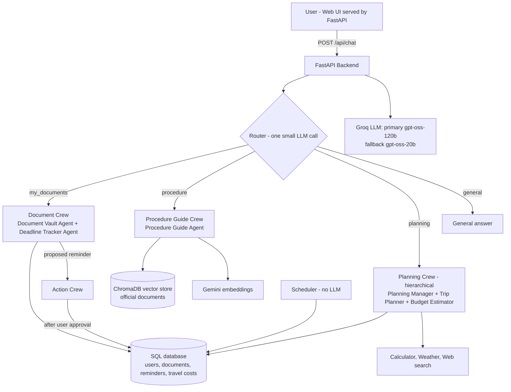
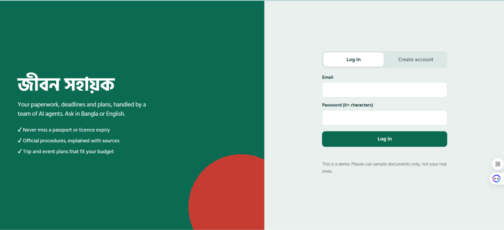
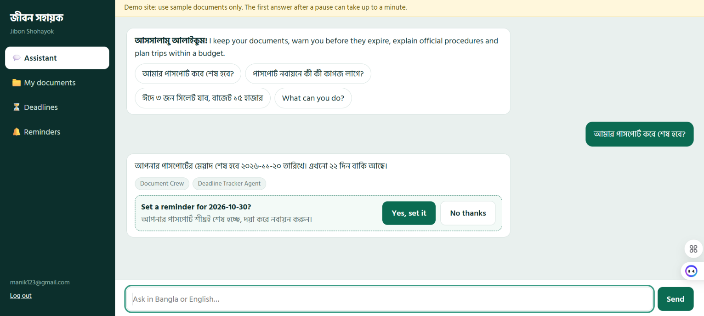
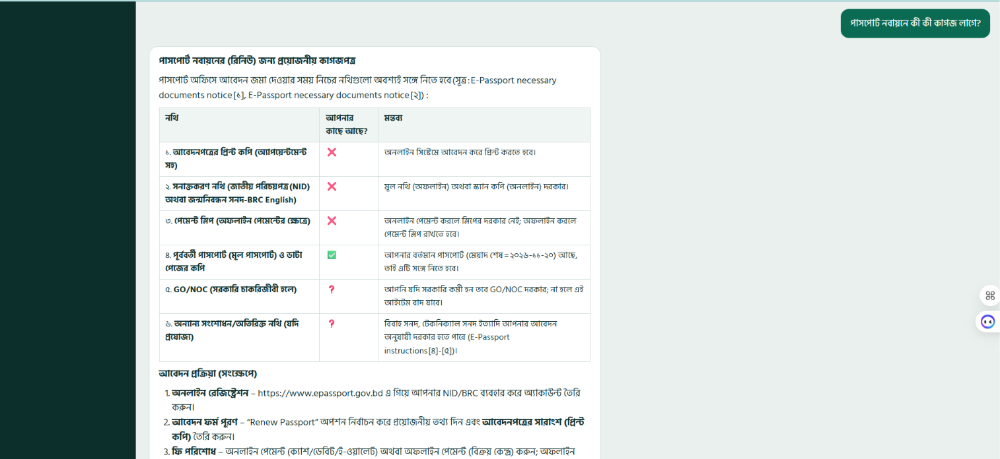
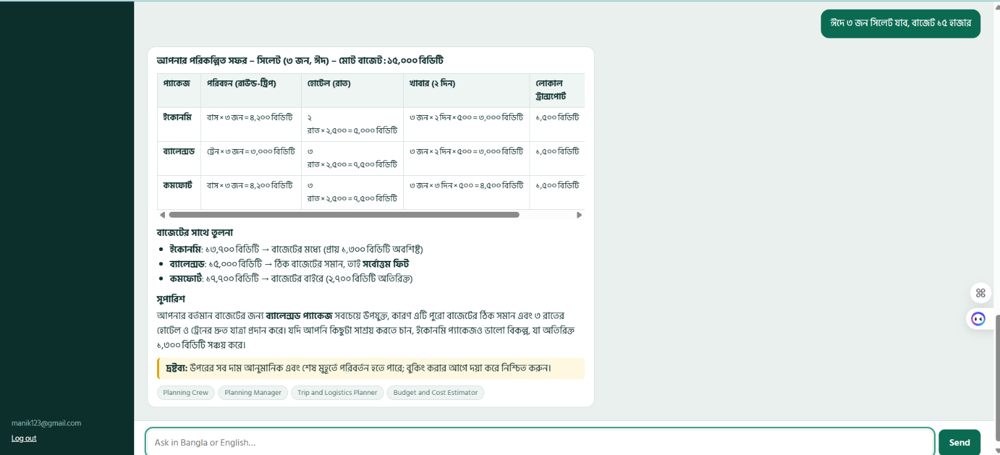
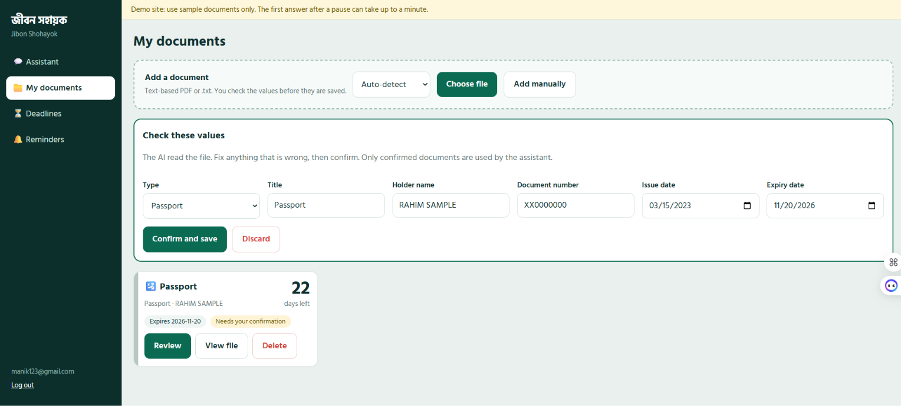
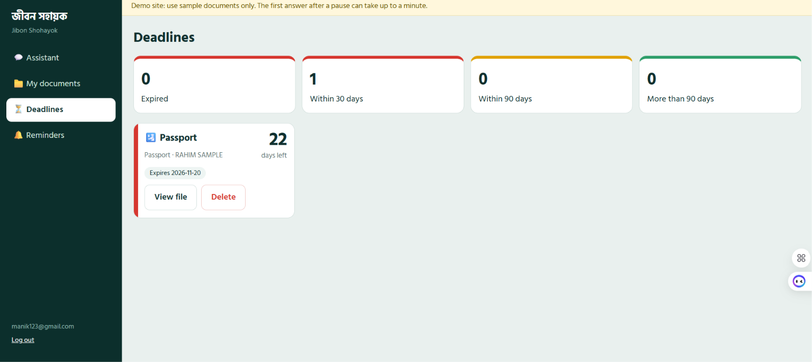
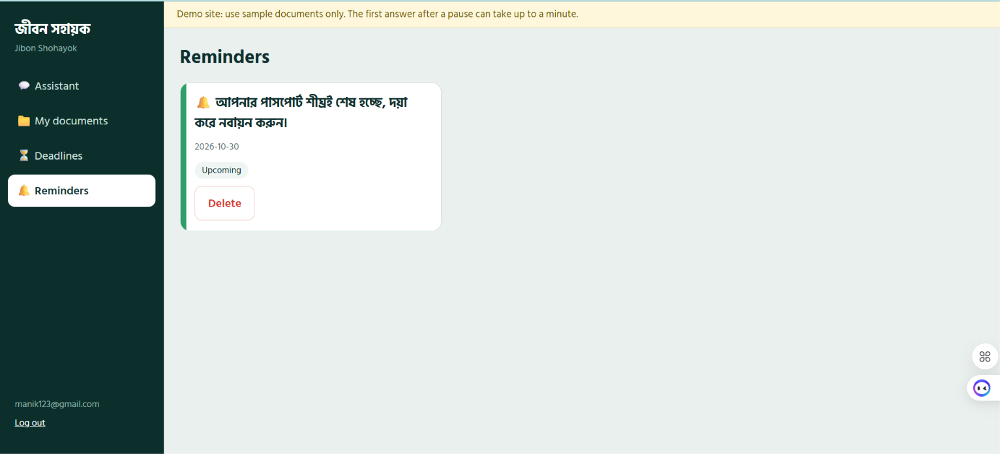

# Jibon Shohayok (জীবন সহায়ক)
### Personal Life-Admin Assistant for People in Bangladesh

> Upload your documents, never miss an expiry date, understand official procedures in Bangla, and plan trips inside your budget, all with a team of AI agents.

**Live demo:** https://jibon-shohayok.onrender.com
**API docs (Swagger):** https://jibon-shohayok.onrender.com/docs
**Health check:** https://jibon-shohayok.onrender.com/health
**Source code:** https://github.com/soumit02/Jibon-shohayok

> ⚠️ **Demo notice:** the live site runs on free tiers (Render free plan, Groq free API). The first request after a pause can take up to a minute, and a trip-planning answer can take 1 to 2 minutes. Please upload **sample documents only**, never real personal documents.

---

## Table of Contents
1. [Problem Statement](#1-problem-statement)
2. [Proposed Solution](#2-proposed-solution)
3. [Key Features](#3-key-features)
4. [Real-Life Impact and Applications](#4-real-life-impact-and-applications)
5. [System Architecture](#5-system-architecture)
6. [AI Models and Methodology](#6-ai-models-and-methodology)
7. [Tech Stack](#7-tech-stack)
8. [Project Structure](#8-project-structure)
9. [Setup Instructions](#9-setup-instructions)
10. [Environment Variables](#10-environment-variables)
11. [Usage Guide](#11-usage-guide)
12. [API Endpoints](#12-api-endpoints)
13. [Deployment](#13-deployment)
14. [Screenshots](#14-screenshots)
15. [Limitations and Honest Notes](#15-limitations-and-honest-notes)
16. [Future Work](#16-future-work)
17. [Author](#17-author)

---

## 1. Problem Statement

Many people in Bangladesh handle important paperwork by memory or on loose paper: passport, driving licence, NID, insurance policies, utility bills. This causes three everyday problems:

1. **Missed deadlines.** A passport, licence or insurance policy expires without warning, which leads to fines, travel problems or loss of cover.
2. **Confusing official procedures.** Information about passport renewal, licence renewal or tax is spread across websites and notices, often in English, and it is hard to know which documents are needed.
3. **Unplanned spending.** Planning a trip (for example, a family trip during Eid) within a fixed budget means searching many places and doing the sums by hand.

## 2. Proposed Solution

**Jibon Shohayok** is a web application that acts as a personal life-admin assistant. The user talks to it in **Bangla or English**. Behind a single chat box, a **router** sends each question to the right **crew of AI agents**:

| Crew | What it does | Process |
|---|---|---|
| **Document Crew** | Reads uploaded documents, extracts expiry dates, answers "when does my passport expire?" | Sequential |
| **Procedure Guide Crew** | Answers questions about official procedures using RAG over official government documents and shows the sources | Sequential |
| **Planning Crew** | Plans trips or events with three costed options (Economy, Balanced, Comfort) and checks them against the budget | Hierarchical |
| **Action Crew** | Creates reminders, **only after the user approves** | Sequential |

## 3. Key Features

- 💬 **Bilingual chat assistant**: ask in Bangla or English, get answers in Bangla.
- 📄 **Document vault**: upload a document, the AI extracts the expiry date, and **you confirm it** before it is saved.
- ⏳ **Deadlines dashboard**: colour-coded view (red, yellow, green) of what expires soon.
- 🔔 **Approval-based reminders**: the AI proposes a reminder, nothing is created until you click "Yes, set it".
- 📚 **RAG with sources**: procedure answers come from official documents, with source names and page numbers. If the system is not confident, it says **"I don't know"** instead of guessing.
- ✅ **Personalised checklists**: required documents are compared with the documents you have already saved (✅ / ❌).
- 🧭 **Budget-aware trip planning**: three costed options, travel prices from a SQL table, weather forecast, one bounded web search, and a limited **re-plan loop** if everything is over budget.
- 🧮 **Calculator tool**: all arithmetic is done by code, never by the language model.
- 🔁 **Automatic backup model**: if the main model fails or is rate-limited, the system switches to a second model and shows a "Backup AI used" badge.
- 🔐 **User accounts**: registration and login with JWT; every tool is bound to the logged-in user in code, so one user can never read another user's documents.
- 🔎 **Transparency**: every answer shows which crew and which agents worked on it.

## 4. Real-Life Impact and Applications

**Impact**
- **Fewer missed renewals.** Early warnings for passport, licence, NID-linked and insurance deadlines save money, time and stress.
- **Easier access to official information.** Procedures from English government pages are explained in simple Bangla, with the source shown, so people can verify them.
- **Better money decisions.** A clear costed comparison helps families choose a trip that fits their budget.
- **Trust by design.** Human approval before actions, "I don't know" for weak answers, and exact facts taken from a database instead of being invented.

**Applications**
- Individuals and families managing their own paperwork.
- Overseas workers and frequent travellers who must track passport and visa validity.
- Small business owners who track trade-licence, insurance and bill deadlines.
- A base that NGOs, banks or government service centres could adapt for citizen-service chat assistants.
- Students and teachers: a worked example of a multi-agent, RAG and tool-calling system built on free tools.

## 5. System Architecture



**Design rules**
1. Exact facts (dates, prices, reminders) live in **SQL**. Text meaning lives in the **vector database**.
2. **Tools do all arithmetic and date calculations**, not the LLM.
3. Tools are created **per user**, with `user_id` fixed in code.
4. Reminders are created **only after approval**.
5. Low RAG confidence means the answer is **"I don't know"**.
6. The reminder scheduler **does not depend on the LLM**.

## 6. AI Models and Methodology

### 6.1 Language models (reasoning and tool calling)
- **Primary:** `openai/gpt-oss-120b` served by **Groq**.
- **Fallback:** `openai/gpt-oss-20b` served by **Groq**.
- Both are called through the OpenAI-compatible API using the CrewAI `LLM` class. `run_with_fallback()` in `app/core/llm.py` tries the primary model and, if it fails, retries with the fallback model.

### 6.2 Multi-agent orchestration (CrewAI)
- A lightweight **Router** (one small LLM call, not an agent) classifies each message as `planning`, `my_documents`, `procedure` or `general`.
- Each crew has its own agents, tasks and tools. The Planning Crew uses a **hierarchical** process (a manager delegates to the planner and the estimator). The others are **sequential**.
- **Bounded re-plan loop:** if the Budget Estimator reports `OVER_BUDGET`, the code asks the crew to re-plan, up to `MAX_REPLANS` times.
- To stay fast on free tiers, `web_search` and `weather_forecast` are limited to **one call per run**, and the planner and estimator have a small `max_iter`.

### 6.3 Retrieval-Augmented Generation (RAG)
1. Official PDFs (for example, passport instructions and notices from the e-Passport website) are stored in `data/gov_docs/` with their source URLs in `sources.json`.
2. `scripts/ingest.py` extracts text, splits it into chunks, creates embeddings with **Gemini `gemini-embedding-001` (768 dimensions)** and stores them in **ChromaDB**.
3. At question time the query is embedded, the most similar chunks are retrieved, and a **similarity threshold** (`RAG_MIN_SCORE`) decides whether the system is confident enough to answer.
4. The Procedure Guide Agent answers in Bangla from the retrieved chunks and returns the **sources** (title, URL, page).
5. A sanity test of the embedding model showed a clear gap between a related pair (score 0.780) and unrelated pairs (0.501 and 0.474).

### 6.4 Tool calling
| Tool | Purpose |
|---|---|
| `lookup_travel_costs` | Reads transport and stay prices from the SQL table |
| `calculator` | Safe arithmetic (AST-based, no `eval`) |
| `weather_forecast` | 7-day forecast from Open-Meteo |
| `web_search` | One short web search for current travel information |
| `search_official_docs` | RAG search over official documents |
| `list_my_documents` | Lists the logged-in user's saved documents |
| `create_reminder` | Proposes a reminder (saved only after approval) |

### 6.5 Document understanding
Text is extracted from uploaded **text-based** PDFs or text files. The Document Vault Agent identifies the document type and expiry date, and the user **confirms or corrects** the result before it is saved. Scanned images (OCR) are not supported yet.

## 7. Tech Stack

| Part | Technology |
|---|---|
| Language | Python 3.11 |
| Backend | FastAPI, SQLAlchemy, APScheduler, JWT authentication |
| Agents | CrewAI |
| LLM | Groq (`gpt-oss-120b`, `gpt-oss-20b`) |
| Embeddings | Google Gemini `gemini-embedding-001` |
| Vector DB | ChromaDB |
| SQL DB | SQLite (local), PostgreSQL (docker-compose, Neon recommended for live) |
| Frontend | Single-page HTML, CSS and JavaScript file served by FastAPI at `/` |
| Containers | Docker, Docker Compose |
| Hosting | Render (free Docker web service) |
| Version control | Git and GitHub |

## 8. Project Structure

```
app/
  main.py                FastAPI app, serves the UI, scheduler, health endpoints
  static/index.html      Web UI (login, chat, documents, deadlines, reminders)
  core/                  config, LLM setup and fallback, security, time helpers
  rag/                   Gemini embeddings and ChromaDB retriever
  db/                    models, session, seed (loads travel_costs.csv)
  tools/                 calculator, weather, web search, DB tools, RAG tools
  crews/                 router, planning, documents, procedure, action
  services/              chat, documents and action services
  api/                   auth, documents, chat, reminders, dependencies
scripts/                 ingest.py, seed_travel_costs.py, test_embedding.py, test_llm.py, try_chat.py
data/
  gov_docs/<topic>/      official PDFs and sources.json
  travel_costs.csv       price list used by the Trip Planner
chroma_store/            vector database built by scripts/ingest.py
Dockerfile
docker-compose.yml
requirements.txt
.env.example
```

## 9. Setup Instructions

### 9.1 Prerequisites
- Python 3.11
- Git
- A free **Groq** API key and a free **Gemini** API key
- (Optional) Docker Desktop

### 9.2 Run locally (Windows PowerShell)

```powershell
# 1. Get the code
git clone https://github.com/soumit02/Jibon-shohayok.git
cd Jibon-shohayok

# 2. Create and activate a virtual environment
python -m venv venv
venv\Scripts\Activate.ps1

# 3. Install dependencies
pip install -r requirements.txt

# 4. Create your .env file and add your own keys
copy .env.example .env

# 5. (Only if chroma_store/ is missing or you changed the PDFs) build the vector database
python scripts/ingest.py

# 6. Start the server
uvicorn app.main:app --reload
```

Open http://127.0.0.1:8000 for the app and http://127.0.0.1:8000/docs for the API docs.

On Linux or macOS, activate the environment with `source venv/bin/activate` and use `cp` instead of `copy`.

### 9.3 Quick tests
```powershell
python scripts/test_embedding.py   # checks the Gemini embedding key
python scripts/test_llm.py         # checks the Groq primary and fallback models
python scripts/try_chat.py         # try the agents from the terminal
```

### 9.4 Run with Docker
```powershell
docker compose up -d --build
docker compose logs -f api
docker compose down
```

## 10. Environment Variables

Copy `.env.example` to `.env`. **Never commit `.env` or share real keys.**

| Variable | Meaning |
|---|---|
| `GROQ_API_KEY`, `BASE_URL`, `MODEL_NAME` | Primary LLM key, API base URL and model name |
| `FALLBACK_API_KEY`, `FALLBACK_BASE_URL`, `FALLBACK_MODEL_NAME` | Backup LLM settings |
| `GEMINI_API_KEY`, `EMBED_MODEL`, `EMBED_DIM`, `EMBED_TPM_BUDGET` | Embedding settings |
| `RAG_COLLECTION`, `RAG_TOP_K`, `RAG_MIN_SCORE` | Vector search settings and confidence threshold |
| `DATABASE_URL` | SQL database URL (empty means local SQLite) |
| `ALLOWED_ORIGINS` | Allowed CORS origins |
| `JWT_SECRET`, `JWT_EXPIRE_HOURS` | Login token settings (use a long random secret in production) |
| `MAX_UPLOAD_MB` | Upload size limit |
| `MAX_REPLANS` | How many times the Planning Crew may re-plan |
| `CHAT_HISTORY_TURNS` | How many past messages are given as context |

## 11. Usage Guide

1. **Sign up and log in** on the home page.
2. Go to **My documents**, upload a **sample** document (text-based PDF or text file), check the extracted type and expiry date, and click **Confirm**.
3. Open **Assistant** and ask: `আমার পাসপোর্ট কবে শেষ হবে?` The Document Crew answers and proposes a reminder. Click **Yes, set it** to approve.
4. Ask a procedure question: `পাসপোর্ট নবায়নে কী কী কাগজ লাগে?` You get a Bangla checklist with sources and ✅ / ❌ against your saved documents.
5. Ask for a plan: `ঈদে ৩ জন সিলেট যাব, বাজেট ১৫ হাজার` The Planning Crew returns three costed options. This can take 1 to 2 minutes on free tiers.
6. Check **Deadlines** (colour-coded) and **Reminders**.

## 12. API Endpoints

| Area | Endpoints |
|---|---|
| Auth | `POST /api/auth/register`, `POST /api/auth/login`, `POST /api/auth/token`, `GET /api/auth/me` |
| Documents | `POST /api/documents/upload`, `POST /api/documents/{id}/confirm`, `POST /api/documents/manual`, `GET /api/documents`, `GET /api/documents/{id}/file`, `DELETE /api/documents/{id}`, `GET /api/dashboard` |
| Chat | `POST /api/chat`, `GET /api/chat/history`, `GET /api/plans`, `GET /api/plans/{id}` |
| Actions | `POST /api/actions/approve`, `GET /api/reminders`, `DELETE /api/reminders/{id}` |
| Profile | `GET /api/profile`, `PUT /api/profile` |
| System | `GET /health`, `GET /health/memory`, `GET /api/rag/search?q=` |

`POST /api/chat` returns: `reply`, `crew`, `agents_used`, `llm_tier`, `proposed_actions`, `sources`, and for plans `plan_id` and `replans`.

## 13. Deployment

The app is deployed as a **Docker web service on Render (free plan)**.

1. Push the repository to GitHub (make sure `chroma_store/` and `data/travel_costs.csv` are committed).
2. On Render, create a **New Web Service** from the repository and choose the **Docker** runtime.
3. Add the environment variables from section 10 in **Render, Environment**.
4. For data that survives restarts, create a free **Neon** PostgreSQL database and set `DATABASE_URL`. Without it, the live site uses temporary SQLite and loses data when it restarts.
5. After every `git push`, Render rebuilds the image. If it does not, press **Manual Deploy, Deploy latest commit**.
6. Verify with `/health` (database and RAG status) and `/health/memory` (the free plan has 512 MB RAM).

## 14. Screenshots

> Add your own screenshots to `docs/screenshots/` and keep the file names below.

| Screen | Image |
|---|---|
| Login and sign-up |  |
| Chat assistant (document question and reminder approval) |  |
| Procedure answer with sources |  |
| Trip plan with three costed options |  |
| My documents and confirmation |  |
| Deadlines dashboard |  |
| Reminders |  |

## 15. Limitations and Honest Notes

- **Free-tier limits.** Groq returns `429 Too Many Requests` when its token limit is reached; the app retries and can switch to the backup model, but a trip plan may take 1 to 2 minutes.
- **Cold start.** The free Render service sleeps after 15 minutes without traffic, so the first request is slow.
- **Text-based files only.** Scanned images and photos are not read (no OCR yet).
- **Prices are estimates.** Travel costs come from a small hand-maintained table and at most one web search. Always verify before booking.
- **Small knowledge base.** The RAG index currently covers a limited set of official passport documents.
- **Not legal advice.** Always confirm procedures on the official website.
- **Demo data only.** Use sample documents, never real personal documents.

## 16. Future Work

- OCR for scanned documents and photos.
- More official sources (driving licence, tax, NID) in the vector database.
- SMS, email or push notifications for reminders.
- A proper evaluation set to measure answer quality and retrieval accuracy.
- Streaming responses for faster perceived speed.
- Paid or higher-limit LLM hosting for stable response times.

## 17. Author

**Soumit Dey**, Bangladesh.
GitHub: https://github.com/soumit02

---
*Jibon Shohayok is an educational project. It does not replace official government services.*
